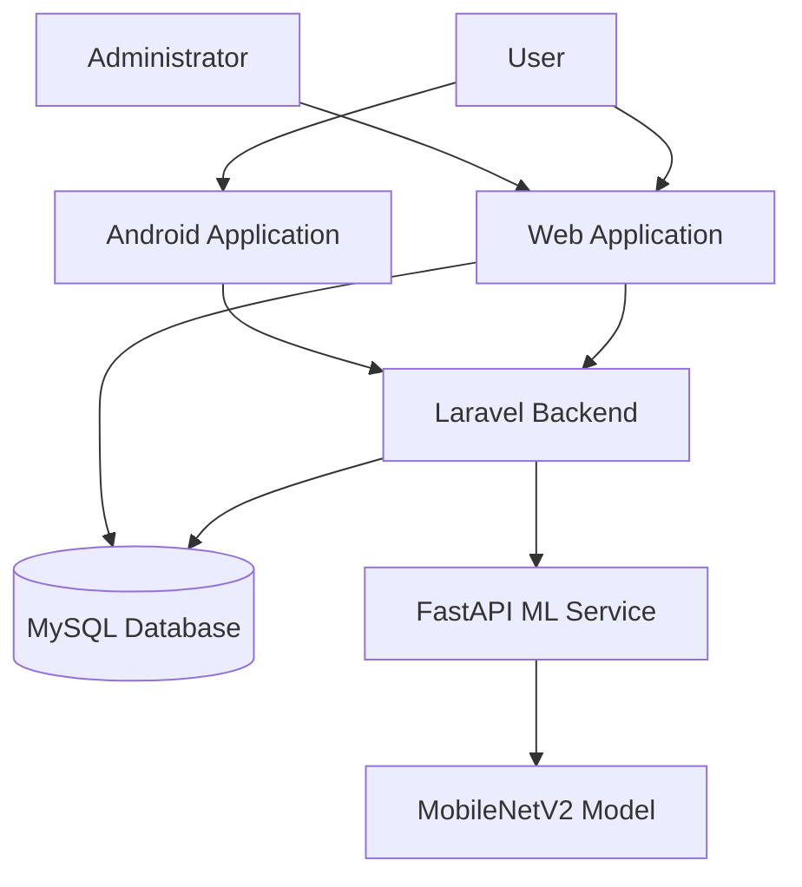

# Smart Waste Management System

A web and mobile-based application for waste reporting, image classification, and report status monitoring.

**Developed for:** Fullstack Developer Technical Coding Test – Bilcode Technology

**Live Website:** https://smartwasteapp.my.id

**GitHub Repository:** https://github.com/AdriandPratama/smart-waste-management

---

## 1. Project Overview

Smart Waste Management is an integrated platform that allows users to report waste conditions through a website or Android application.

Users can submit waste reports with images and location coordinates, classify waste images using Machine Learning, and monitor report status updates.

Administrators can review submitted reports, verify the information, and update report statuses.

The system consists of three main components:
- Web Application
- Android Mobile Application
- Machine Learning Classification Service

## 2. Main Features

### User Website
- User registration and login.
- Submit waste reports with descriptions and images.
- Capture location coordinates using GPS.
- AI-based waste image classification.
- View report history and status updates.

### Admin Dashboard
- View submitted waste reports.
- Review report details and images.
- Verify submitted reports.
- Update report statuses.
- Monitor report statistics.

### Android Application
- User authentication.
- Dashboard and waste category information.
- Submit waste reports with images and location.
- View report history.
- Receive updated report verification statuses.

### Machine Learning
- Image classification using MobileNetV2.
- Three supported categories:
  - Organic
  - Paper
  - Plastic
- FastAPI-based prediction service.
- Prediction confidence score.

## 3. Technology Stack

| Component | Technology |
|---|---|
| Backend | Laravel, PHP |
| Frontend | Laravel Blade |
| Database | MySQL |
| API Authentication | Laravel Sanctum |
| Mobile | Flutter, Dart |
| Machine Learning | Python, TensorFlow, Keras |
| Model | MobileNetV2 |
| ML API | FastAPI, Uvicorn |
| Web Server | Nginx |
| Operating System | Ubuntu 24.04 |
| Deployment | VPS, HTTPS |

## 4. System Architecture



## 5. Waste Reporting Workflow

1. User logs in through the website or Android application.
2. User creates a waste report with an image and location.
3. The image can be classified using the Machine Learning service.
4. Laravel stores the report in the MySQL database.
5. Administrator reviews and verifies the report.
6. The updated report status is displayed to the user.

## 6. Machine Learning Evaluation

The MobileNetV2 model was evaluated using a separate test dataset containing 512 images across three categories.

| Metric | Result |
|---|---:|
| Test Images | 512 |
| Correct Predictions | 496 |
| Test Accuracy | 96.88% |
| Test Loss | 0.1074 |

### Classification Report

| Category | Precision | Recall | F1-score |
|---|---:|---:|---:|
| Organic | 1.00 | 0.98 | 0.99 |
| Paper | 0.95 | 0.94 | 0.94 |
| Plastic | 0.97 | 0.98 | 0.97 |

These metrics represent the model's performance on the evaluation dataset and may differ from real-world prediction results.

## 7. Production Deployment

The application is deployed on a VPS using Ubuntu 24.04.

**Production URL:** https://smartwasteapp.my.id

Production components:
- Nginx Web Server
- Laravel Application
- MySQL Database
- FastAPI Machine Learning Service
- HTTPS using Certbot

The website and Android application have been tested against the production backend, including report submission and administrator verification.

## 8. Project Structure

```text
smart-waste-management/
├── app/
├── bootstrap/
├── config/
├── database/
├── docs/
├── ml/
├── mobile/
├── public/
├── resources/
├── routes/
├── storage/
├── tests/
├── README.md
└── README_ID.md
```

## 9. Local Installation

### Requirements

- PHP and Composer
- MySQL
- Python 3.12
- Flutter SDK
- Android SDK
- Git

### Step 1: Clone Repository

```bash
git clone https://github.com/AdriandPratama/smart-waste-management.git
cd smart-waste-management
```

### Step 2: Configure Laravel

```bash
composer install
```

Create the environment file.

Windows PowerShell:

```powershell
Copy-Item .env.example .env
```

Linux/macOS:

```bash
cp .env.example .env
```

Generate application key:

```bash
php artisan key:generate
```

Configure MySQL credentials in `.env`, then run:

```bash
php artisan migrate
php artisan db:seed --class=WasteCategorySeeder
php artisan storage:link
```

Configure the ML service URL in `.env`:

```dotenv
ML_API_URL=http://127.0.0.1:8000
```

Start Laravel:

```bash
php artisan serve --port=8001
```

### Step 3: Run Machine Learning Service

```bash
cd ml
python -m venv venv
```

Activate the environment.

Windows PowerShell:

```powershell
.\venv\Scripts\Activate.ps1
```

Linux/macOS:

```bash
source venv/bin/activate
```

Install dependencies and run FastAPI:

```bash
pip install -r requirements.txt
uvicorn app.main:app --host 127.0.0.1 --port 8000 --reload
```

FastAPI documentation:

`http://127.0.0.1:8000/docs`

### Step 4: Run Android Application

Open another terminal:

```bash
cd mobile
flutter pub get
```

Configure the API base URL in:

`lib/config/api_config.dart`

For Android Emulator:

```dart
static const String baseUrl = 'http://10.0.2.2:8001/api';
```

For production:

```dart
static const String baseUrl = 'https://smartwasteapp.my.id/api';
```

Run Flutter:

```bash
flutter run
```

### Step 5: Build Release APK

```bash
flutter build apk --release
```

APK output:

```text
build/app/outputs/flutter-apk/app-release.apk
```

## 10. API Documentation

The REST API is provided by Laravel.

Local API base URL:

`http://127.0.0.1:8001/api`

The API supports:
- User registration and login.
- User authentication.
- Waste category retrieval.
- Image classification.
- Waste report submission.
- Report history and details.
- Administrator report verification.

Protected API endpoints use Laravel Sanctum bearer-token authentication.

For detailed endpoint documentation, see the `docs/` directory.

## 11. Database

Main database tables:
- users
- waste_categories
- waste_reports
- report_images
- report_status_histories
- personal_access_tokens

The Entity Relationship Diagram (ERD) is available in the `docs/` directory.

## 12. Security

- Production credentials are stored in server environment variables.
- `.env` files must not be committed to GitHub.
- Production traffic uses HTTPS.
- The Machine Learning service is restricted to internal server access.

## 13. Developer

**Adriand Pratama**

GitHub: https://github.com/AdriandPratama

---

Developed as a Fullstack Developer Technical Coding Test project for Bilcode Technology.
