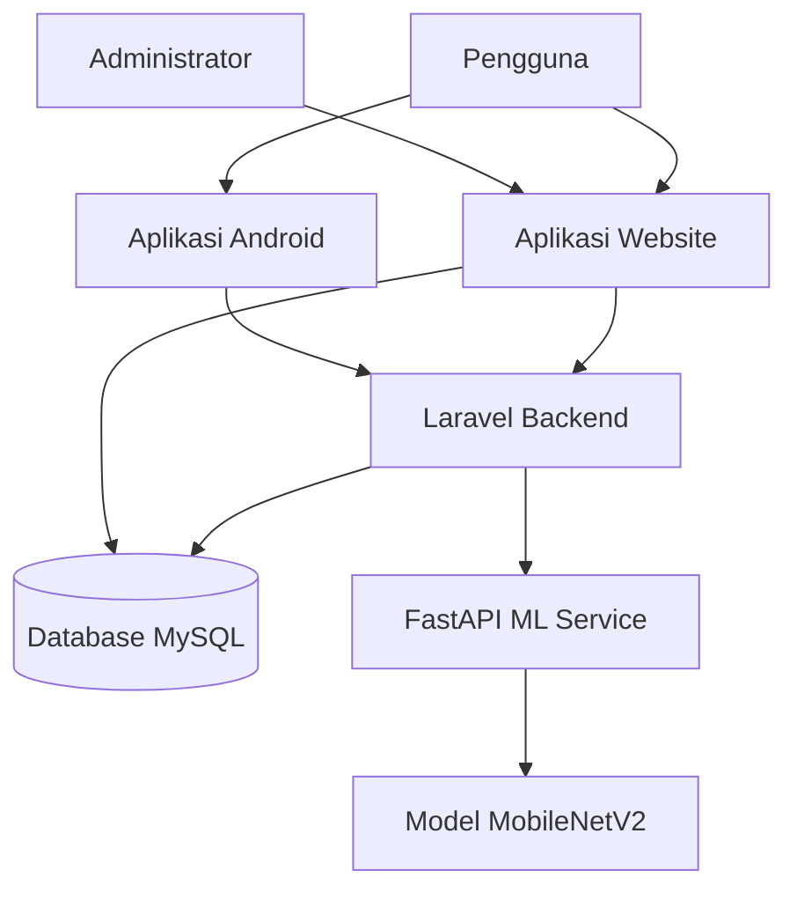

# Smart Waste Management System

Aplikasi berbasis web dan Android untuk pelaporan sampah, klasifikasi gambar menggunakan Machine Learning, serta pemantauan status laporan.

**Dikembangkan untuk:** Technical Coding Test Fullstack Developer – Bilcode Technology

**Website Demo:** https://smartwasteapp.my.id

**Repository GitHub:** https://github.com/AdriandPratama/smart-waste-management

---

## 1. Gambaran Umum Project

Smart Waste Management merupakan platform terintegrasi yang memungkinkan pengguna melaporkan kondisi sampah melalui website maupun aplikasi Android.

Pengguna dapat mengirim laporan dengan melampirkan gambar dan koordinat lokasi, melakukan klasifikasi gambar sampah menggunakan Machine Learning, serta memantau perkembangan status laporan.

Administrator dapat memeriksa laporan yang masuk, melakukan verifikasi, dan memperbarui status laporan.

Sistem ini terdiri dari tiga komponen utama:
- Aplikasi Website
- Aplikasi Mobile Android
- Layanan Klasifikasi Machine Learning

## 2. Fitur Utama

### Website Pengguna
- Registrasi dan login pengguna.
- Membuat laporan sampah dengan deskripsi dan gambar.
- Mengambil koordinat lokasi menggunakan GPS.
- Klasifikasi gambar sampah menggunakan AI.
- Melihat riwayat dan perkembangan status laporan.

### Dashboard Admin
- Melihat laporan sampah dari pengguna.
- Memeriksa detail laporan dan gambar.
- Melakukan verifikasi laporan.
- Memperbarui status laporan.
- Memantau statistik laporan.

### Aplikasi Android
- Autentikasi pengguna.
- Menampilkan informasi dashboard dan kategori sampah.
- Mengirim laporan dengan gambar dan lokasi.
- Melihat riwayat laporan.
- Menerima pembaruan status verifikasi laporan.

### Machine Learning
- Klasifikasi gambar menggunakan MobileNetV2.
- Mendukung tiga kategori sampah:
  - Organik
  - Kertas
  - Plastik
- FastAPI sebagai layanan prediksi gambar.
- Menghasilkan kategori prediksi dan nilai confidence.

## 3. Teknologi yang Digunakan

| Komponen | Teknologi |
|---|---|
| Backend | Laravel, PHP |
| Frontend | Laravel Blade |
| Database | MySQL |
| Autentikasi API | Laravel Sanctum |
| Mobile | Flutter, Dart |
| Machine Learning | Python, TensorFlow, Keras |
| Model Klasifikasi | MobileNetV2 |
| ML API | FastAPI, Uvicorn |
| Web Server | Nginx |
| Sistem Operasi Server | Ubuntu 24.04 |
| Deployment | VPS, HTTPS |

## 4. Arsitektur Sistem



## 5. Alur Pelaporan Sampah

1. Pengguna login melalui website atau aplikasi Android.
2. Pengguna membuat laporan dengan melampirkan gambar dan lokasi.
3. Gambar dapat diklasifikasikan menggunakan layanan Machine Learning.
4. Laravel menyimpan laporan ke database MySQL.
5. Administrator memeriksa dan memverifikasi laporan.
6. Status laporan terbaru ditampilkan kepada pengguna.

## 6. Hasil Evaluasi Machine Learning

Model MobileNetV2 dievaluasi menggunakan dataset pengujian terpisah yang terdiri dari 512 gambar dengan tiga kategori sampah.

| Metrik | Hasil |
|---|---:|
| Jumlah Gambar Pengujian | 512 |
| Prediksi Benar | 496 |
| Akurasi Pengujian | 96,88% |
| Loss Pengujian | 0,1074 |

### Classification Report

| Kategori | Precision | Recall | F1-score |
|---|---:|---:|---:|
| Organik | 1,00 | 0,98 | 0,99 |
| Kertas | 0,95 | 0,94 | 0,94 |
| Plastik | 0,97 | 0,98 | 0,97 |

Hasil tersebut menunjukkan performa model pada dataset pengujian yang digunakan saat evaluasi. Akurasi yang sama tidak dijamin untuk setiap gambar dalam penggunaan sebenarnya.

File model dan hasil evaluasi tersedia di direktori `ml/`.

## 7. Deployment Production

Aplikasi telah di-deploy pada VPS menggunakan Ubuntu 24.04.

**Website Production:** https://smartwasteapp.my.id

Komponen production:
- Nginx Web Server
- Laravel Application
- MySQL Database
- FastAPI Machine Learning Service
- HTTPS menggunakan Certbot

Website dan aplikasi Android telah diuji menggunakan backend production, termasuk proses pengiriman laporan dan verifikasi oleh administrator.

## 8. Struktur Repository

```text
smart-waste-management/
├── app/
├── bootstrap/
├── config/
├── database/
├── docs/
├── ml/
├── mobile/
├── public/
├── resources/
├── routes/
├── storage/
├── tests/
├── README.md
└── README_ID.md
```

## 9. Instalasi dan Konfigurasi Lokal

### Persyaratan

Sebelum menjalankan project, pastikan perangkat sudah memiliki:
- PHP dan Composer
- MySQL
- Python 3.12
- Flutter SDK
- Android SDK
- Git

### Langkah 1: Clone Repository

```bash
git clone https://github.com/AdriandPratama/smart-waste-management.git
cd smart-waste-management
```

### Langkah 2: Konfigurasi Laravel

Install dependency PHP:

```bash
composer install
```

Buat file environment.

Windows PowerShell:

```powershell
Copy-Item .env.example .env
```

Linux/macOS:

```bash
cp .env.example .env
```

Generate application key:

```bash
php artisan key:generate
```

Buat database MySQL, lalu sesuaikan konfigurasi database pada file `.env`:

```dotenv
DB_CONNECTION=mysql
DB_HOST=127.0.0.1
DB_PORT=3306
DB_DATABASE=smart_waste_management
DB_USERNAME=your_database_user
DB_PASSWORD=your_database_password
```

Jalankan migration dan seeder kategori sampah:

```bash
php artisan migrate
php artisan db:seed --class=WasteCategorySeeder
```

Buat symbolic link untuk file upload:

```bash
php artisan storage:link
```

Atur URL layanan Machine Learning pada `.env`:

```dotenv
ML_API_URL=http://127.0.0.1:8000
```

Jalankan Laravel pada port `8001`:

```bash
php artisan serve --port=8001
```

URL Website lokal: `http://127.0.0.1:8001`

Base URL API lokal: `http://127.0.0.1:8001/api`

### Langkah 3: Menjalankan Machine Learning Service

Buka terminal baru:

```bash
cd ml
python -m venv venv
```

Aktifkan virtual environment.

Windows PowerShell:

```powershell
.\venv\Scripts\Activate.ps1
```

Linux/macOS:

```bash
source venv/bin/activate
```

Install dependency Python dan jalankan FastAPI:

```bash
pip install -r requirements.txt
uvicorn app.main:app --host 127.0.0.1 --port 8000 --reload
```

Base URL FastAPI: `http://127.0.0.1:8000`

Dokumentasi API: `http://127.0.0.1:8000/docs`

Laravel akan mengakses layanan Machine Learning melalui URL yang ditentukan pada `ML_API_URL`.

### Langkah 4: Menjalankan Aplikasi Flutter

Buka terminal baru:

```bash
cd mobile
flutter pub get
```

Atur base URL API pada file:

`lib/config/api_config.dart`

Untuk Android Emulator:

```dart
static const String baseUrl = 'http://10.0.2.2:8001/api';
```

Untuk perangkat Android fisik, gunakan alamat IP LAN komputer development yang dapat dijangkau perangkat.

Untuk production:

```dart
static const String baseUrl = 'https://smartwasteapp.my.id/api';
```

Jalankan aplikasi:

```bash
flutter run
```

### Langkah 5: Build APK Release

Dari direktori `mobile/`, jalankan:

```bash
flutter build apk --release
```

File APK akan dihasilkan pada:

```text
build/app/outputs/flutter-apk/app-release.apk
```

## 10. Dokumentasi REST API

Base URL API untuk development lokal:

`http://127.0.0.1:8001/api`

API menyediakan fungsi:
- Registrasi dan login pengguna.
- Autentikasi pengguna.
- Pengambilan kategori sampah.
- Klasifikasi gambar.
- Pengiriman laporan sampah.
- Pengambilan riwayat dan detail laporan.
- Verifikasi laporan oleh administrator.

Endpoint API yang dilindungi menggunakan autentikasi bearer token Laravel Sanctum.

Detail endpoint, request, dan response tersedia di direktori `docs/`.

## 11. Struktur Database

Tabel utama yang digunakan:
- `users`
- `waste_categories`
- `waste_reports`
- `report_images`
- `report_status_histories`
- `personal_access_tokens`

Entity Relationship Diagram (ERD) tersedia di direktori `docs/`.

## 12. Keamanan

- Kredensial production disimpan pada environment server.
- File `.env` tidak boleh diunggah ke GitHub.
- Akses production menggunakan HTTPS.
- Layanan Machine Learning dibatasi untuk akses internal server.

## 13. Developer

**Adriand Pratama**

GitHub: https://github.com/AdriandPratama

---

Project ini dikembangkan sebagai bagian dari Technical Coding Test Fullstack Developer di Bilcode Technology.
