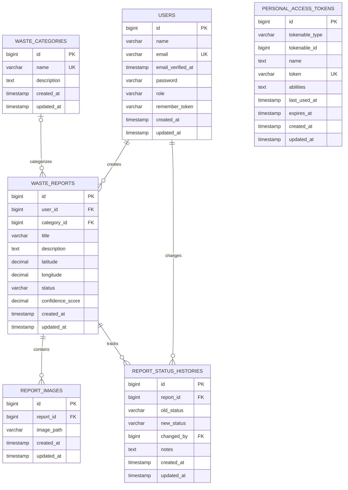

# Smart Waste Management - Database ERD

Dokumentasi ERD untuk database `smart_waste_management`.

## Entity Relationship Diagram

## Table Relationships

| Parent Table | Child Table | Foreign Key |
|---|---|---|
| users | waste_reports | user_id |
| users | report_status_histories | changed_by |
| waste_categories | waste_reports | category_id |
| waste_reports | report_images | report_id |
| waste_reports | report_status_histories | report_id |

## Notes

- PK: Primary Key
- FK: Foreign Key
- UK: Unique Key
- `category_id` pada waste_reports bersifat nullable.
- `personal_access_tokens` menggunakan relasi polymorphic Laravel melalui `tokenable_type` dan `tokenable_id`.
- Tabel bawaan Laravel seperti cache, jobs, sessions, dan migrations tidak ditampilkan karena diagram berfokus pada tabel utama aplikasi.
